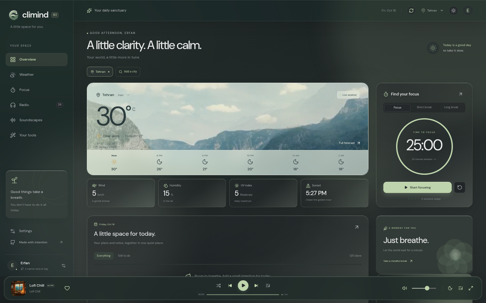
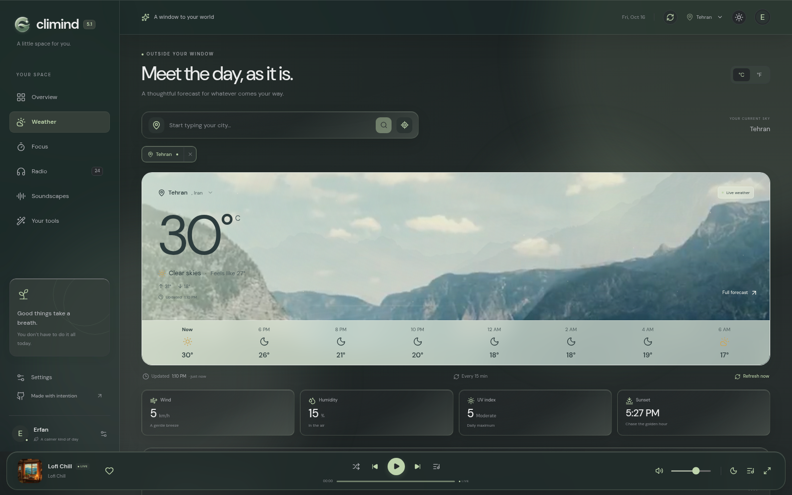
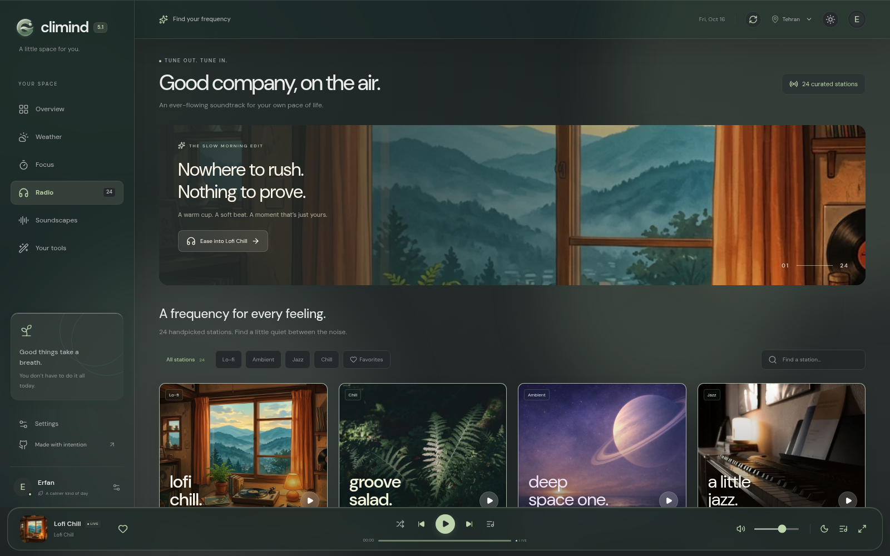
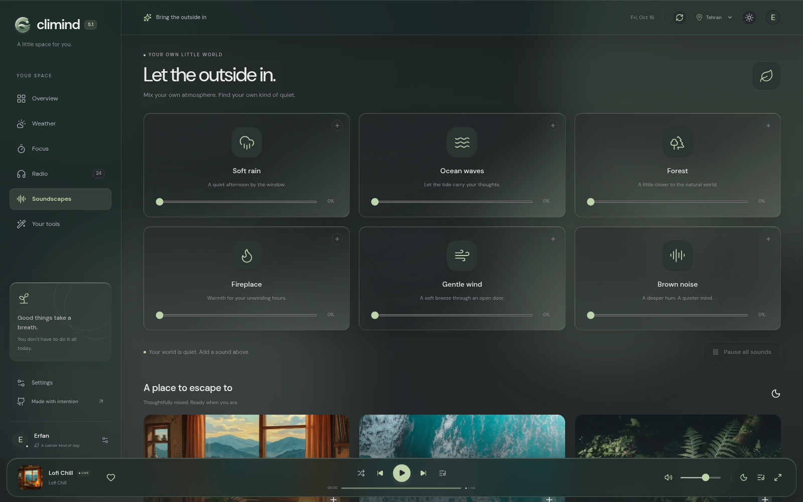
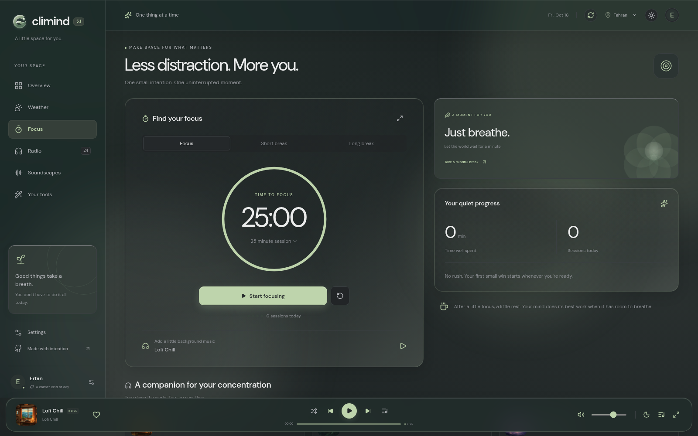
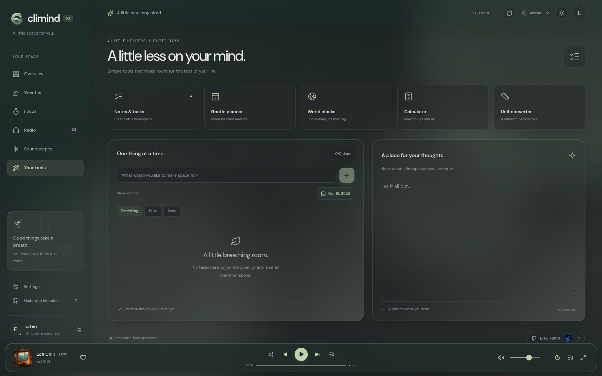
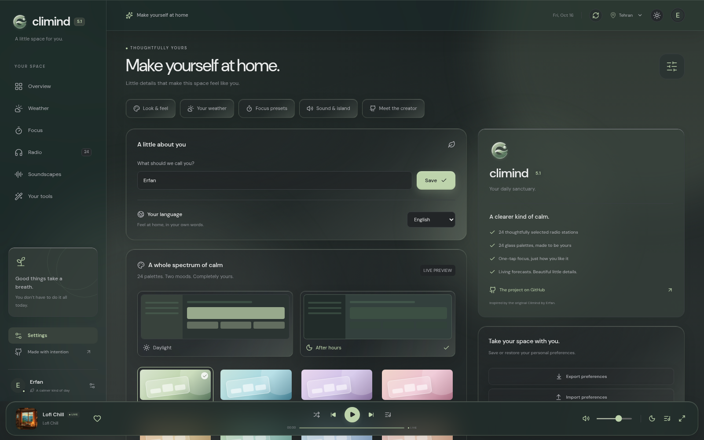

<div align="center">

# Climind 5.1.5

**Your daily sanctuary.**

*A thoughtful space for weather, focus, live radio, and little moments of calm.*

One file. Zero dependencies. In English & فارسی. Everything stays on your device.

[](https://erfan.climind.pages.dev/)
[](#-whats-new-in-v51)
[](LICENSE)
[](#-tech-stack)
[](https://github.com/Erfan-8910/Climind-W/stargazers)

</div>

---

<div align="center">



*Overview — live weather, focus at a glance, your plans and a daily thought, all in one quiet place.*

</div>

---

## ✦ Why Climind?

Climind started as a weather app. **v5.1 turns it into a sanctuary** — a calm,
thoughtfully designed space that opens with your day and follows your rhythm:
the sky outside your window, a focus session when you need one, a radio
station when you want company, and nature sounds when you want quiet.

And it's still **a single `index.html`**. The whole app — fonts, artwork,
sounds and all — lives in one file you can open anywhere, on anything:

- **One file, truly portable** — every asset is embedded. No install, no server, no internet required to run it.
- **Zero dependencies at runtime** — no CDN calls, no framework loading, nothing to break.
- **100% private** — notes, sessions and preferences never leave your device. No account, no tracking.
- **Two languages, one soul** — a full English **and** Persian (فارسی) experience, with a Persian (Solar Hijri) calendar option.

---

## ✦ See it in action

| 🪟 Overview | ☀️ Weather |
| :---: | :---: |
|  |  |
| *Your whole day, in one quiet view* | *"Meet the day, as it is."* |

| 📻 Radio | 🌊 Soundscapes |
| :---: | :---: |
|  |  |
| *24 handpicked stations, "Good company, on the air."* | *Mix your own atmosphere, generated on your device* |

| 🧠 Focus | 🧰 Your tools |
| :---: | :---: |
|  |  |
| *"Less distraction. More you."* | *Notes, planner, clocks, calculator, converter* |

| ⚙️ Personalize | |
| :---: | :---: |
|  | |
| *24 glass palettes, two moods, live preview* | |

---

## ✦ What's new in v5.1 — *The Sanctuary Release*

v5.1 isn't an update. **It's a rebirth.** The entire app was re-imagined from
the ground up — new engine, new design language, new soul:

- **Rebuilt on a modern engine** — a component-based rewrite, compiled into one self-contained HTML file. Everything (fonts, artwork, station art, sounds) ships inside it.
- **Seven full pages** — Overview · Weather · Focus · **Radio** · **Soundscapes** · Your tools · Settings. No more cramped single page.
- **📻 Radio, a whole new world** — 24 handpicked stations (Lofi Chill, Groove Salad, Deep Space One, Secret Agent, Mission Control…) with favorites, search, genre filters and a beautiful glass player.
- **🌊 Soundscapes, made by your device** — soft rain, ocean waves, forest, fireplace, gentle wind, brown noise — synthesized live in your browser and mixable with per-sound volumes.
- **🏝️ Dynamic Island** — a floating glass island for radio & focus controls that follows you across every page.
- **🫁 Mindful breathing** — guided box-breathing rounds when you need a pause.
- **🪟 Liquid Glass engine** — 24 palettes × 2 moods (Daylight / After hours) × 4 surfaces with a live glass-strength slider.
- **🇮🇷 Fully bilingual** — English & فارسی everywhere, plus Persian (Solar Hijri) calendar support.
- **💾 Take your space with you** — export & restore your preferences as a JSON file.
- **🌤️ Richer weather** — wind & direction, gusts, pressure, visibility, dew point, UV, precipitation probability, sunrise/sunset, and an auto-refresh interval you choose.

> Upgrading from v5.0? v5.1 is a fresh start with its own storage — your v5 data stays untouched. Set it up once (name, theme, city) and you're home.

---

## ✦ Feature tour

### ☀️ Weather — *"Meet the day, as it is."*

| | |
|---|---|
| **Now** | Temperature, feels-like, condition & a live photo backdrop that matches your sky |
| **Details** | Wind + direction, gusts, humidity, pressure, visibility, dew point, cloud cover |
| **Sun & UV** | Sunrise, sunset & daily UV index with plain-language guidance |
| **Rain** | Precipitation amount & probability, hour by hour |
| **Forecasts** | Hourly strip + 7-day outlook with temperature ranges |
| **Cities** | Global search, saved-city chips & one-tap geolocation |
| **Auto-refresh** | You choose the rhythm: 5 / 10 / 15 / 30 / 60 minutes or manual |

### 🧠 Focus — *"Less distraction. More you."*

| | |
|---|---|
| **Sessions** | Focus · Short break · Long break — or set any length from 1 to 120 minutes |
| **Your atmosphere** | Attach a radio station or a soundscape mix (with volumes) to each session |
| **Gentle end** | A soft chime when time's up — toggle it in settings |
| **Quiet progress** | Time spent & sessions today, counted without judgment |
| **Island controls** | Pause, resume or reset right from the Dynamic Island |

### 📻 Radio — *"Good company, on the air."*

| | |
|---|---|
| **24 curated stations** | Lofi, ambient, jazz & chill — Lofi Chill, Groove Salad, Deep Space One, Drone Zone, Secret Agent, Mission Control, Space Station Soma and more |
| **Find your frequency** | Search, genre filters (Lo-fi · Ambient · Jazz · Chill) & favorites |
| **Glass player** | A full player bar with shuffle, queue & volume — like the streaming apps |
| **Lock-screen ready** | Media-session controls on supported devices |

### 🌊 Soundscapes — *"Let the outside in."*

| | |
|---|---|
| **Made on your device** | Rain, ocean waves, forest, fireplace, gentle wind, brown noise — synthesized live, no downloads |
| **Mix & match** | Layer any sounds with individual volume sliders |
| **Escape presets** | Thoughtfully pre-mixed atmospheres, ready when you are |

### 🧰 Your tools — *"A little less on your mind."*

| Tool | What it does |
|---|---|
| **📝 Notes & Tasks** | To-dos with a "make room on" date + a free-form notebook for your thoughts |
| **📅 Gentle planner** | Room for what matters — plans without the pressure |
| **🌍 World clocks** | Tehran, London, New York, Tokyo, Dubai & Paris |
| **🧮 Calculator** | Instant answers with a quiet history |
| **🔄 Unit converter** | Length, mass & temperature from a different perspective |
| **🫁 Breathing** | Guided box-breathing rounds — about a minute to reset |

### ⚙️ Personalize — *"Make yourself at home."*

**Look & feel** — 24 glass palettes × Daylight / After hours × 4 surfaces
(Classic, Frosted, Crystal, Liquid) with a live **glass-strength** slider ·
animated backgrounds · **Dynamic Island** toggle · reduced-motion respect.

**Your weather** — °C / °F, refresh interval, city management.

**Sound & island** — island radio behavior, chime, default start.

**Language & calendar** — English / فارسی / automatic, Gregorian or
**Persian (Solar Hijri)** calendar, 12/24-hour clock.

**Take your space with you** — export all preferences to
`climind-my-space.json` and restore them anywhere, anytime.

---

## ✦ Quick start

**One command** — download, install and launch:

```bash
curl -fsSL https://raw.githubusercontent.com/Erfan-8910/Climind-W/Version-5.1/install.sh -o install.sh
chmod +x install.sh
./install.sh
```

The script auto-detects Python or Node.js, downloads the app, finds a free
port and prints the URL. That's it — open **http://localhost:8080** and step
into your sanctuary.

> Prefer another folder? `CLIMIND_DIR=/opt/climind ./install.sh`

### The installer does everything

```bash
./install.sh              # Interactive menu (install / start / update / check / remove)
./install.sh install      # Fresh install to ~/climind
./install.sh start        # Launch the local server
./install.sh update       # Pull the latest version from GitHub (with backup)
./install.sh check        # Compare your local version vs. GitHub
./install.sh remove       # Uninstall completely (asks first)
./install.sh --version    # Print installer version
./install.sh --help       # All flags & options
```

| Flag | Description |
|---|---|
| `install` | Fresh install (offline-friendly: reuses a local `index.html` if present) |
| `start` | Start the server on a free port (8080+) |
| `update` | Download the latest release — backs up your current copy first |
| `check` | Check for updates without installing |
| `remove`, `--yes` | Uninstall (`--yes` skips the confirmation) |
| `--dir <path>` | Install to a custom directory |
| `--port <n>` | Force a specific port |

### No terminal? Deploy in 60 seconds

| Platform | How |
|---|---|
| **Cloudflare Pages** ⭐ | Fork → connect repo → build command: *(none)* → output dir: `/` |
| **GitHub Pages** | Push → Settings → Pages → deploy from a branch |
| **Vercel / Netlify** | Drag & drop the folder — live URL in 30 seconds |

Or keep it truly simple: just open `index.html` in your browser. It works.

---

## ✦ Tech stack

<div align="center">

**React** + react-router — *7-page sanctuary, component-based UI*
**Motion** — *springy, gentle, `prefers-reduced-motion` aware*
**Web Audio API** — *soundscapes synthesized on-device + focus chime*
**Open-Meteo** — *weather & forecast · **SomaFM + Lofi 24/7** — live radio*
**CSS `color-mix` + backdrop-filter** — *the Liquid Glass engine*

*Everything compiled into one `index.html` — no build step to run it, no CDN, no runtime bloat.*

</div>

---

## ✦ Roadmap

The sanctuary keeps growing. Rough plan, in no strict order:

- [ ] **PWA + offline mode** — install Climind to your home screen
- [ ] **More soundscapes** — café, campfire crackle, night crickets…
- [ ] **Focus stats** — weekly and monthly trends of your quiet progress
- [ ] **More languages** — the sanctuary welcoming even more of the world
- [ ] **Planner upgrades** — repeating events and gentle reminders
- [ ] **Widget mode** — a tiny always-on-weather card

> Have an idea? [Open an issue](https://github.com/Erfan-8910/Climind-W/issues) — the roadmap is shaped by its residents.

---

## ✦ Found a bug?

**We need your eyes.** Climind is built by one developer and a community of
users — every report makes it better. Please
[open an issue](https://github.com/Erfan-8910/Climind-W/issues) with your
browser & version, your OS, steps to reproduce, and a screenshot if it's
visual. Thank you! 🙏

---

## ✦ Star the project ⭐

Building a zero-dependency, double-language, single-file sanctuary takes late
nights and an unreasonable love for calm software. If Climind made your day a
little quieter, a star is the best thank-you a developer can get:

<div align="center">

### [⭐ Star Climind-W on GitHub](https://github.com/Erfan-8910/Climind-W/stargazers)

[](https://star-history.com/#Erfan-8910/Climind-W&Date)

</div>

---

<div align="center">

Made with intention by **[Erfan](https://github.com/Erfan-8910)** and **AI**

*Climind 5.1 — Your daily sanctuary*

[Live Demo](https://erfan.climind.pages.dev/) · [Report a Bug](https://github.com/Erfan-8910/Climind-W/issues) · [MIT License](LICENSE)

</div>
